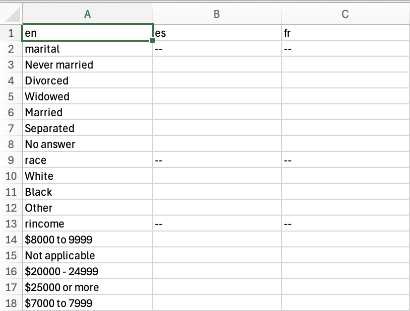
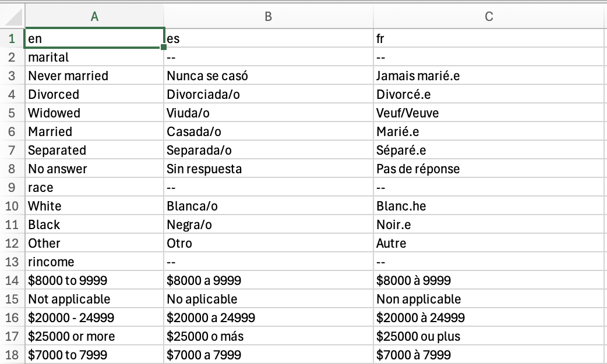

# A workflow for creating translation tables

``` r

library(transcats)
```

The `transcats` package is designed to make it easy to translated
categorical, tabular data (and other data with repeated values) between
multiple languages.

## Set-Up

For this example, we’ll create a translation table for the variables in
`gss_cat`, a data table from the General Social Survey that is include
in the package `forcats`. Here’s a look at gss_cat:

``` r

library(forcats) # loads gss_cat

forcats::gss_cat
#> # A tibble: 21,483 × 9
#>     year marital         age race  rincome        partyid    relig denom tvhours
#>    <int> <fct>         <int> <fct> <fct>          <fct>      <fct> <fct>   <int>
#>  1  2000 Never married    26 White $8000 to 9999  Ind,near … Prot… Sout…      12
#>  2  2000 Divorced         48 White $8000 to 9999  Not str r… Prot… Bapt…      NA
#>  3  2000 Widowed          67 White Not applicable Independe… Prot… No d…       2
#>  4  2000 Never married    39 White Not applicable Ind,near … Orth… Not …       4
#>  5  2000 Divorced         25 White Not applicable Not str d… None  Not …       1
#>  6  2000 Married          25 White $20000 - 24999 Strong de… Prot… Sout…      NA
#>  7  2000 Never married    36 White $25000 or more Not str r… Chri… Not …       3
#>  8  2000 Divorced         44 White $7000 to 7999  Ind,near … Prot… Luth…      NA
#>  9  2000 Married          44 White $25000 or more Not str d… Prot… Other       0
#> 10  2000 Married          47 White $25000 or more Strong re… Prot… Sout…       3
#> # ℹ 21,473 more rows
```

Numerical variables—`year`, `age`, and `tvhours` don’t need a
translation, but factor-based variables do. **(Be careful!** Some text
variables, like names, geographic locations, and organizations, might
not need to be translated, depending on the context and languages
involved.) This code creates a short list of those variable names:

``` r

# select names of all of the factor and character variables
# in gss_cat
gss_cat %>% dplyr::select(where(~ is.factor(.x) || is.character(.x))) %>%
  names() -> gss_cat_trans_variables
gss_cat %>% dplyr::select(where(~ is.numeric(.x))) %>%
  names() -> gss_cat_num_variables

gss_cat_trans_variables
#> [1] "marital" "race"    "rincome" "partyid" "relig"   "denom"
```

To work on this with `transcats`, we set the source language to English
and name destination languages using `set_source_lang` and
`set_dest_lang_list`, choosing Spanish and French. Note that these
language codes are two-letter shortcodes by convention, not requirement.
Just work to be consistent across a project. You may also use longer
language codes, or modify language codes to indicate variations. The
package uses `r_variable` as a language code to designate variable
names.

``` r

set_source_lang("en")
set_dest_lang_list(c("es", "fr"))
```

## Creating a translation table

Translation in `transcats` is done with manually created or verified
translation tables for each possible value of the variable in question.
The function `create_blank_translation_table` creates a table for one
variable:

``` r

marital_trans_table <- create_blank_translation_table(gss_cat, "marital")
marital_trans_table
#>              en es fr
#> 1     No answer      
#> 2 Never married      
#> 3     Separated      
#> 4      Divorced      
#> 5       Widowed      
#> 6       Married
```

The slightly differently named `create_blank_translation_tables` (with a
final **s**) creates a cluster of such tables, given a list of
variables. By default, this merges the tables into one long dataframe
that can be exported for translation by hand.

``` r

gss_translation_combined <- create_blank_translation_tables(gss_cat,
                                                            gss_cat_trans_variables)
gss_translation_combined
#>                en es fr
#> 1         marital -- --
#> 2       No answer      
#> 3   Never married      
#> 4       Separated      
#> 5        Divorced      
#> 6         Widowed      
#> 7         Married      
#> 8            race -- --
#> 9           Other      
#> 10          Black      
#> 11          White      
#> 12 Not applicable      
#> 13        rincome -- --
#>  [ reached 'max' / getOption("max.print") -- omitted 75 rows ]
```

With different preferences, this table can be put directly in the
`transcats` preferred translation table-list format. (But the blank
entries mean this won’t work for translation.)

``` r

gss_translation <- create_blank_translation_tables(gss_cat, gss_cat_trans_variables, combine_tables = FALSE)
gss_translation 
#> $marital
#>              en es fr
#> 1       marital -- --
#> 2     No answer      
#> 3 Never married      
#> 4     Separated      
#> 5      Divorced      
#> 6       Widowed      
#> 7       Married      
#> 
#> $race
#>               en es fr
#> 1           race -- --
#> 2          Other      
#> 3          Black      
#> 4          White      
#> 5 Not applicable      
#> 
#> $rincome
#>               en es fr
#> 1        rincome -- --
#> 2      No answer      
#> 3     Don't know      
#> 4        Refused      
#> 5 $25000 or more      
#> 6 $20000 - 24999      
#> 7 $15000 - 19999      
#> 8 $10000 - 14999      
#>  [ reached 'max' / getOption("max.print") -- omitted 9 rows ]
#> 
#> $partyid
#>                   en es fr
#> 1            partyid -- --
#> 2          No answer      
#> 3         Don't know      
#> 4        Other party      
#> 5  Strong republican      
#> 6 Not str republican      
#> 7       Ind,near rep      
#> 8        Independent      
#>  [ reached 'max' / getOption("max.print") -- omitted 3 rows ]
#> 
#> $relig
#>                        en es fr
#> 1                   relig -- --
#> 2               No answer      
#> 3              Don't know      
#> 4 Inter-nondenominational      
#> 5         Native american      
#> 6               Christian      
#> 7      Orthodox-christian      
#> 8            Moslem/islam      
#>  [ reached 'max' / getOption("max.print") -- omitted 9 rows ]
#> 
#> $denom
#>                     en es fr
#> 1                denom -- --
#> 2            No answer      
#> 3           Don't know      
#> 4      No denomination      
#> 5                Other      
#> 6            Episcopal      
#> 7   Presbyterian-dk wh      
#> 8 Presbyterian, merged      
#>  [ reached 'max' / getOption("max.print") -- omitted 23 rows ]
```

### Editing the translation table externally

Now we can write the combined table into an external file, available for
editing via an external text editor or spreadsheet program.

``` r

do_not_run <- TRUE

if(!do_not_run){
readr::write_excel_csv(
  gss_translation_combined,
  "inst/extdata/gss_cat_transtable.csv")
}
```

Editing by hand, or using machine translation and then editing the
results, we fill in the table.



The completed .csv can be imported back into R. Use
`parse_combined_translation_table` to turn the combined list into a
`transcats` list of translation tables.

``` r

library(fs)

gss_translation_combined <- 
  readr::read_csv(fs::path_package("extdata", "gss_cat_transtable_complete.csv",
                                         package = "transcats"))
#> Rows: 86 Columns: 3
#> ── Column specification ────────────────────────────────────────────────────────
#> Delimiter: ","
#> chr (3): en, es, fr
#> 
#> ℹ Use `spec()` to retrieve the full column specification for this data.
#> ℹ Specify the column types or set `show_col_types = FALSE` to quiet this message.
gss_translation <- parse_combined_translation_table(gss_translation_combined)
gss_translation
#> $marital
#> # A tibble: 6 × 3
#>   en            es            fr            
#>   <chr>         <chr>         <chr>         
#> 1 Never married Nunca se casó Jamais marié.e
#> 2 Divorced      Divorciada/o  Divorcé.e     
#> 3 Widowed       Viuda/o       Veuf/Veuve    
#> 4 Married       Casada/o      Marié.e       
#> 5 Separated     Separada/o    Séparé.e      
#> 6 No answer     Sin respuesta Pas de réponse
#> 
#> $race
#> # A tibble: 3 × 3
#>   en    es       fr      
#>   <chr> <chr>    <chr>   
#> 1 White Blanca/o Blanc.he
#> 2 Black Negra/o  Noir.e  
#> 3 Other Otro     Autre   
#> 
#> $rincome
#> # A tibble: 16 × 3
#>    en             es              fr            
#>    <chr>          <chr>           <chr>         
#>  1 $8000 to 9999  $8000 a 9999    $8000 à 9999  
#>  2 Not applicable No aplicable    Non applicable
#>  3 $20000 - 24999 $20000 a 24999  $20000 à 24999
#>  4 $25000 or more $25000 o más    $25000 ou plus
#>  5 $7000 to 7999  $7000 a 7999    $7000 à 7999  
#>  6 $10000 - 14999 $10000 a 14999  $10000 à 14999
#>  7 Refused        Rechazado       Refusé        
#>  8 $15000 - 19999 $15000 a 19999  $15000 à 19999
#>  9 $3000 to 3999  $3000 a 3999    $3000 à 3999  
#> 10 $5000 to 5999  $5000 a 5999    $5000 à 5999  
#> 11 Don't know     No sabe         Ne sait pas   
#> 12 $1000 to 2999  $1000 a 2999    $1000 à 2999  
#> 13 Lt $1000       Menos que $1000 Moins de $1000
#> 14 No answer      Sin respuesta   Pas de réponse
#> 15 $6000 to 6999  $6000 a 6999    $6000 à 6999  
#> 16 $4000 to 4999  $4000 a 4999    $4000 à 4999  
#> 
#> $partyid
#> # A tibble: 10 × 3
#>    en                 es                                fr                      
#>    <chr>              <chr>                             <chr>                   
#>  1 Ind,near rep       Independiente, casi republicana/o Indépendant.e, proche d…
#>  2 Not str republican Republicana/o, no fuerte          Républicain.e, pas fort…
#>  3 Independent        Independiente                     Indépendant.e           
#>  4 Not str democrat   Demócrata, no fuerte              Démocrate, pas fort.e   
#>  5 Strong democrat    Demócrata  fuerte                 Démocrate fort.e        
#>  6 Ind,near dem       Independiente, casi demócrata     Indépendant.e, proche d…
#>  7 Strong republican  Republicana/o fuerte              Républicain.e fort.e    
#>  8 Other party        Otro partido                      Autre parti politique   
#>  9 No answer          Sin respuesta                     Pas de réponse          
#> 10 Don't know         No sabe                           Ne sait pas             
#> 
#> $relig
#> # A tibble: 15 × 3
#>    en                      es                     fr                      
#>    <chr>                   <chr>                  <chr>                   
#>  1 Protestant              Protestante            Protestant              
#>  2 Orthodox-christian      Cristiano ortodoxo     Chrétien orthodoxe      
#>  3 None                    Ninguno                Aucune religion         
#>  4 Christian               Cristiano              Chrétien                
#>  5 Jewish                  Judío                  Juif                    
#>  6 Catholic                Católico               Catholique              
#>  7 Other                   Otro                   Autre                   
#>  8 Inter-nondenominational Interconfesional       Interconfessionnel      
#>  9 Hinduism                Hindú                  Hindou                  
#> 10 Native american         Indígena americano     Amérindien              
#> 11 No answer               Sin respuesta          Pas de réponse          
#> 12 Buddhism                Budista                Bouddhiste              
#> 13 Moslem/islam            Musulmán               Musulman                
#> 14 Other eastern           Otra religión oriental Autre religion orientale
#> 15 Don't know              No sabe                Ne sait pas             
#> 
#> $denom
#> # A tibble: 30 × 3
#>    en                es                               fr                        
#>    <chr>             <chr>                            <chr>                     
#>  1 Southern baptist  Bautista del Sur                 Baptiste du Sud           
#>  2 Baptist-dk which  Bautista, no sabe cuál           Baptiste, ne sait pas leq…
#>  3 No denomination   Sin denominación                 Aucune dénomination       
#>  4 Not applicable    No corresponde                   Sans objet                
#>  5 Lutheran-mo synod Sínodo luterano-misuri           Synode luthérien-Missouri 
#>  6 Other             Otro                             Autre                     
#>  7 United methodist  Metodista unido                  Méthodiste uni            
#>  8 Episcopal         Episcopal                        Épiscopal                 
#>  9 Other lutheran    Otro luterano                    Autre luthérien           
#> 10 Afr meth ep zion  African Methodist Episcopal Zion Méthodiste africain Épisc…
#> # ℹ 20 more rows
```

The imported translation table is now available to do data translation
using `translated_join_vars`.

## Translating categorical data

``` r

set_active_translation_table(gss_translation)
set_source_lang("en")
set_dest_lang("fr")
gss_cat_2 <- translated_join_vars(gss_cat, gss_cat_trans_variables)

gss_cat_fr <- gss_cat_2 %>% dplyr::select(-all_of(gss_cat_trans_variables))

# reorder to match original
gss_cat_fr <- gss_cat_fr %>% dplyr::relocate(age, .after="marital_fr") %>%
                             dplyr::relocate(tvhours, .after="denom_fr")

# gss_cat_fr_variables <- g
```

Let’s compare the input and and output:

``` r

knitr::kable(head(gss_cat, 12))
```

| year | marital | age | race | rincome | partyid | relig | denom | tvhours |
|---:|:---|---:|:---|:---|:---|:---|:---|---:|
| 2000 | Never married | 26 | White | \$8000 to 9999 | Ind,near rep | Protestant | Southern baptist | 12 |
| 2000 | Divorced | 48 | White | \$8000 to 9999 | Not str republican | Protestant | Baptist-dk which | NA |
| 2000 | Widowed | 67 | White | Not applicable | Independent | Protestant | No denomination | 2 |
| 2000 | Never married | 39 | White | Not applicable | Ind,near rep | Orthodox-christian | Not applicable | 4 |
| 2000 | Divorced | 25 | White | Not applicable | Not str democrat | None | Not applicable | 1 |
| 2000 | Married | 25 | White | \$20000 - 24999 | Strong democrat | Protestant | Southern baptist | NA |
| 2000 | Never married | 36 | White | \$25000 or more | Not str republican | Christian | Not applicable | 3 |
| 2000 | Divorced | 44 | White | \$7000 to 7999 | Ind,near dem | Protestant | Lutheran-mo synod | NA |
| 2000 | Married | 44 | White | \$25000 or more | Not str democrat | Protestant | Other | 0 |
| 2000 | Married | 47 | White | \$25000 or more | Strong republican | Protestant | Southern baptist | 3 |
| 2000 | Married | 53 | White | \$25000 or more | Not str democrat | Protestant | Other | 2 |
| 2000 | Married | 52 | White | \$25000 or more | Ind,near rep | None | Not applicable | NA |

``` r

knitr::kable(head(gss_cat_fr, 12))
```

| year | marital_fr | age | race_fr | rincome_fr | partyid_fr | relig_fr | denom_fr | tvhours |
|---:|:---|---:|:---|:---|:---|:---|:---|---:|
| 2000 | Jamais marié.e | 26 | Blanc.he | \$8000 à 9999 | Indépendant.e, proche du républicain.e | Protestant | Baptiste du Sud | 12 |
| 2000 | Divorcé.e | 48 | Blanc.he | \$8000 à 9999 | Républicain.e, pas fort.e | Protestant | Baptiste, ne sait pas lequel | NA |
| 2000 | Veuf/Veuve | 67 | Blanc.he | Non applicable | Indépendant.e | Protestant | Aucune dénomination | 2 |
| 2000 | Jamais marié.e | 39 | Blanc.he | Non applicable | Indépendant.e, proche du républicain.e | Chrétien orthodoxe | Sans objet | 4 |
| 2000 | Divorcé.e | 25 | Blanc.he | Non applicable | Démocrate, pas fort.e | Aucune religion | Sans objet | 1 |
| 2000 | Marié.e | 25 | Blanc.he | \$20000 à 24999 | Démocrate fort.e | Protestant | Baptiste du Sud | NA |
| 2000 | Jamais marié.e | 36 | Blanc.he | \$25000 ou plus | Républicain.e, pas fort.e | Chrétien | Sans objet | 3 |
| 2000 | Divorcé.e | 44 | Blanc.he | \$7000 à 7999 | Indépendant.e, proche du démocrate | Protestant | Synode luthérien-Missouri | NA |
| 2000 | Marié.e | 44 | Blanc.he | \$25000 ou plus | Démocrate, pas fort.e | Protestant | Autre | 0 |
| 2000 | Marié.e | 47 | Blanc.he | \$25000 ou plus | Républicain.e fort.e | Protestant | Baptiste du Sud | 3 |
| 2000 | Marié.e | 53 | Blanc.he | \$25000 ou plus | Démocrate, pas fort.e | Protestant | Autre | 2 |
| 2000 | Marié.e | 52 | Blanc.he | \$25000 ou plus | Indépendant.e, proche du républicain.e | Aucune religion | Sans objet | NA |
